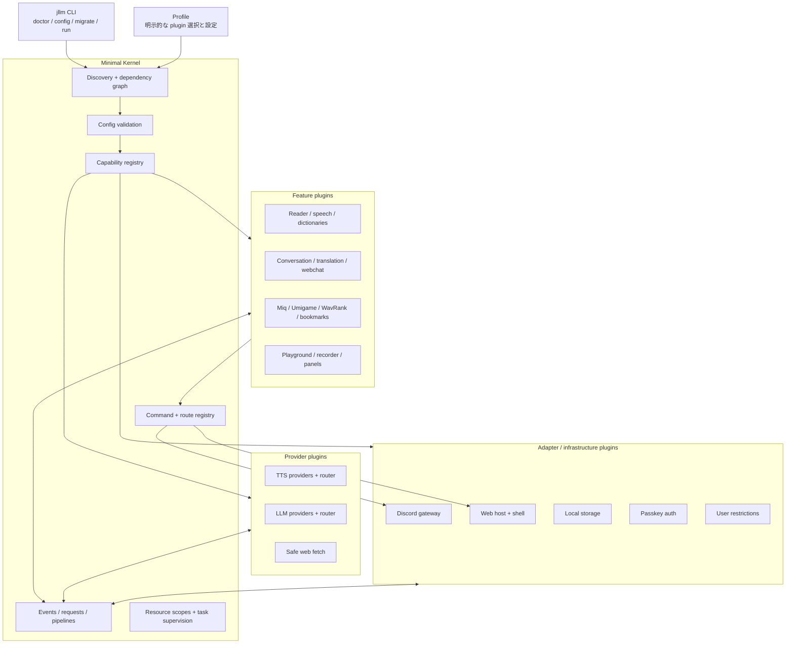
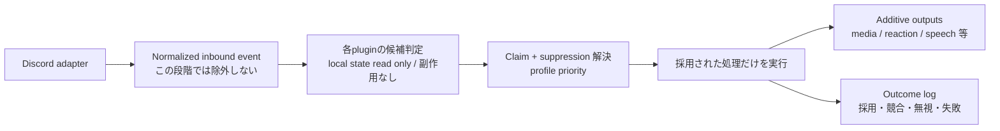

# jllm-voice 全プラグイン化 再設計書

- 日付: 2026-10-28
- 状態: 実装前の提案（調査に基づく目標設計）
- 対象: 新しい `jllm-bot-system`。既存 `jllm-voice` と本番データはこの設計作業では変更していない
- 調査: DeepSeek Harness 0.2.1-rc.3 / Cordis、既存ソース、旧セッション `session-90214d93-d25a-463e-9542-3a3b840fa4ad`

## 0. 結論

**Python 3.14 / discord.py / asyncio を維持したまま、DSH の設計思想を移した小さな microkernel と、独立に有効化・差し替えできる論理プラグイン群へ移行する。配布は初期の少数 bundle と、必要が証明された独立 package に分ける。**

TypeScript や Cordis 自体を抱え込まない。移植するのは次の概念である。

- 明示的に選択する profile / bundle
- plugin manifest と entry point
- 具象 plugin ではなく version 付き capability への依存
- 起動前の設定検証
- plugin ごとの resource 所有と逆順 cleanup
- 型付き event、request、command の分離
- host / client を分けた UI 拡張

「ALL プラグイン化」は**すべての主要機能・外部接続・永続化方式を差し替え可能にする**意味とする。純粋関数やファイル単位まで無条件に plugin 化しない。plugin は、設定・状態・command・UI・外部 resource を所有する交換単位である。

初期版は in-process で、**profile を変えて再起動する差し替え**を保証する。DSH の動的 HMR まで初期に複製しない。稼働中の VC、再生 queue、remote GPU service を安全に drain する方が優先度が高い。

## 1. 現状から確定した事実

### 1.1 起動と結合

現行の [main.py](/home/ryu/irodori-tts/jllm-voice/main.py#L39-L89) は、TTS → Reader → Miq → Translation → WavRank → Umigame → Dashboard の順に具象 class を直接生成する。Dashboard には Reader と Translation の内部 object を渡している。

主な結合点は次のとおり。

- [reader.py](/home/ryu/irodori-tts/jllm-voice/cogs/reader.py) は 3,921 行で、読み上げ、VC、話者設定、辞書、media、HTML、画像生成、bookmark、help などを抱える。
- [translation.py](/home/ryu/irodori-tts/jllm-voice/cogs/translation.py) は 1,116 行で、翻訳、会話、要約、session、queue を抱える。
- [dashboard.py](/home/ryu/irodori-tts/jllm-voice/services/dashboard.py) は 1,189 行で、Web の route を集中登録し、各機能の具象 service を直接 import する。
- [config.py](/home/ryu/irodori-tts/jllm-voice/config.py) は 567 行の import-time 環境変数設定であり、`.env` の後に `bot-policy.env` を override する。
- Reader、Translation、Miq、Umigame がそれぞれ `on_message` を持ち、trigger の抑止を相互の具象関数で行う。
- [user_restrictions.py](/home/ryu/irodori-tts/jllm-voice/services/user_restrictions.py#L165-L187) は `bot.restrictions` に遅延 singleton を置き、複数 Cog が共有する。
- Dashboard の一部は Reader の dictionary、media、player、保存 method を直接操作する。Cog を別 process に分けるだけでは即時反映が壊れる。
- TTS backend は [registry.py](/home/ryu/irodori-tts/jllm-voice/services/tts/registry.py#L8-L19) の global registry と import 副作用に依存する。
- Miq 内部にも登録用の循環 import がある。機械的な遅延 import や process 分割は避ける。

現行には 54 個の test file がある。旧セッションの最終報告には「987 passed」とあるが、それは当時の報告であり、今回その tests を再実行したものではない。

### 1.2 旧セッションから復元した互換要件

旧セッションと前身の直接要求は、Miq 上流 PR の確認、Discord Bot への反映、UX 変更の取り込みだった。旧作業の結果として次は互換性調査の対象に含める。

- `miq`、`miqmiq` による同一人物の最大 10 発言
- 33 構図、番号・向き・系統指定、`vs` / `love` / `talk`
- 台帳、help、最大 4 画像の collage、spoiler ぼかし、caption
- 自然文を Miq command と誤認しない
- Discord CDN 限定、redirect 禁止、size・pixel 数制限などの安全策

旧報告で見送られた描き直し UI button などは、移行完了条件に含めない。旧報告の tests・deploy 結果は現時点の稼働保証として扱わない。

### 1.3 移行前の特別な注意

管理元の working tree には、未 commit の変更と未追跡の機能（Umigame、WavRank など）が多数ある。**Git HEAD だけを移行元にしない。** 実装開始前に、管理元の working tree、x230 の稼働 code、設定差分を照合し、移行 baseline を固定する。

本番 `data/`、`.env`、辞書、音声、認証情報の管理元は x230 である。初期 migration は必ず複製に対して行い、元データを in-place 変換しない。

## 2. DSH から採用する設計

### 2.1 対応表

| DSH / Cordis | jllm-voice への採用 | 採用しない部分 |
| --- | --- | --- |
| profile が bundle を明示選択 | YAML profile が plugin id と instance を allowlist 選択 |  install 済み plugin の無条件自動起動 |
| manifest / entry point | `importlib.metadata.entry_points` + `plugin.json` | Node module resolution の再現 |
| `ctx.inject` / service | version 付き capability registry と scoped `PluginContext` | 具象 plugin 同士の import |
| fiber / disposer | plugin ごとの resource scope、LIFO cleanup、task 終了待ち | 初期版の自動再起動 fiber 全体 |
| Standard Schema / Config | 起動前の型付き config 検証・正規化 | import 時の環境変数評価 |
| emit / serial / bail / waterfall | 通知 `emit`、単一応答 `request`、順序付き `pipeline` の 3 種類 | 初日から全 event 種別を複製すること |
| command registry | plugin が宣言し、core が一意性検査と Discord 同期を行う | 機能ごとの個別同期 |
| host / client 拡張 | 単一 Web host + shell、機能 plugin が route / panel を提供 | 機能ごとの HTTP server |
| HMR | 将来の検討事項 | VC / queue を持つ plugin の初期 hot reload |

実装根拠として、DSH の [profile package](/home/ryu/.dsh/profiles/web/package.json#L30-L46) は bundle を明示選択し、[dsh-web-mcp](/home/ryu/.dsh/profiles/web/bundles-src/dsh-web-mcp/package.json#L20-L23) は bundle の patch を manifest から示す。Cordis の [registry.ts](/home/ryu/.dsh/runtime/node_modules/@deepseek-ai/cordis/src/registry.ts#L91-L132) は inject / provide の契約、[fiber.ts](/home/ryu/.dsh/runtime/node_modules/@deepseek-ai/cordis/src/fiber.ts#L68-L93) は effect / disposer の所有を担う。

### 2.2 最も重要な依存規則

**機能 plugin は `provider.tts.voicevox` や `provider.llm.sarashina` に依存しない。`tts.synthesis@1` や `llm.chat@1` に依存する。**

これにより、利用側の code・command・UI を変えずに provider だけを交換できる。profile の plugin 記述順は起動順ではなく、capability graph が起動順を決める。

### 2.3 capability の cardinality と binding

複数 provider と router が存在するため、capability 名だけでは解決しない。provider 向けと利用者向けの契約を分ける。

| 契約 | cardinality | 消費者 |
| --- | --- | --- |
| `tts.provider@1` | many | `tts.router` だけ |
| `tts.synthesis@1` | one | Reader、Playground など |
| `llm.provider@1` | many | `llm.router` だけ |
| `llm.chat@1` | one | Translation、Conversation など |

- `one` を自動選択しない。複数 provider の曖昧な解決、未知の instance、version 不整合は profile / binding の構造不正として、全 plugin を開始する前に拒否する。
- 必須 `one` の provider が profile で無効・未 install のため 0 件の場合は、構造不正ではなく依存先の `BLOCKED` として扱う。ただし依存先が critical なら全体の起動を中止する。
- `many` は profile の明示的で順序付きの binding を使い、「install 済み全部」を暗黙に束ねない。
- `optional_one` は 0 または 1 を許す。2 件以上は binding が必要である。
- instance id は capability 内で一意の `<plugin>/<instance>` とする。
- API の major version が違うものは接続しない。minor の互換規則は contract ごとに定める。

```yaml
bindings:
  tts.router:
    tts.provider:
      - provider.tts.openai/drama3-home
      - provider.tts.voicevox/local
  feature.reader:
    tts.synthesis: tts.router/main
```

kernel は capability を id、version、instance、object として扱い、TTS や LLM の型を import しない。domain ごとの Protocol と data 型は独立した **contract package** に置き、provider と消費者だけが同じ contract package に依存する。

### 2.4 配布単位と論理 plugin を分ける

約 40 の論理 plugin を、最初から約 40 の独立 Python distribution にしない。初期は少数の配布 bundle にまとめ、manifest・dependency・test は論理 plugin ごとに独立させる。

次の条件が証明されたものから独立 distribution へ昇格する。

- 単独で交換・release する需要がある
- optional / native dependency を分離する必要がある
- 他 plugin への具象 import がなく、contract test が独立して通る

Miq は重い描画依存を分離するため初期から独立候補とするが、単純な機能を配布単位まで細分化しない。

## 3. 目標と非目標

### 3.1 目標

1. core が主要機能を import しない。
2. profile だけで機能を有効化・無効化できる。
3. TTS、LLM、storage、Discord 接続、Web 認証を契約単位で交換できる。
4. plugin の設定・依存・route・command・data 所有者を機械的に検査できる。
5. plugin ごとに optional dependency を分け、無効な機能の native library を不要にする。
6. 既存の command、会話 session、辞書、音声、TTS failover、Miq UX を壊さず移行する。
7. plugin 単位の contract test と、旧挙動との compatibility test を用意する。

### 3.2 初期版の非目標

- 信頼できない第三者 plugin の sandbox
- 全 plugin の無停止 hot reload
- Node.js sidecar や TypeScript への全面書き換え
- 機能の全面再設計や新規 UX の同時追加
- 全機能を別 process / container に分けること
- 旧挙動の未検証な不具合らしき箇所を、移行と同時にまとめて直すこと

## 4. 目標アーキテクチャ



### 4.1 core に残すもの

- plugin API version、manifest、capability、event data などの安定した型
- discovery、profile 選択、dependency graph
- config 検証、secret 参照解決
- capability registry
- event / request / pipeline 基盤
- command / route の一意性検査と登録仲介
- resource scope、async task 監督、shutdown
- structured log、health、clock、CLI

core は Discord、TTS、LLM、辞書、Miq、会話などの名前を知らない。

### 4.2 process モデル

初期版は 1 process / 1 asyncio event loop。各 plugin は専用 resource scope を持つ。

- 曖昧な binding、未知の instance、version 不整合などの構造不正は profile 検証で全体を拒否し、どの plugin も開始しない。
- 構造が正しい profile で required capability の provider が無効 / 未 install の場合、その依存先は `BLOCKED` とし、理由を `doctor` と log に出す。独立した非 critical 機能は継続する。
- `BLOCKED` / `FAILED` の連鎖先に critical plugin が含まれる場合は全体の起動を中止する。
- optional capability がない場合は、その拡張だけを登録しない。plugin 自体は動作できる。
- `required` は dependency 関係、`critical` は process 方針であり、別の属性とする。
- Discord gateway など `critical: true` の初期化失敗時だけ、開始済みの全 plugin を逆順停止して起動を中止する。
- 非 critical plugin の初期化失敗は、その plugin と依存先を `FAILED` / `BLOCKED` にし、独立機能は継続する。
- 稼働後の service 故障は health event と明示した retry 方針で扱う。初期版は Cordis のような動的な依存再構成を行わない。
- すべての購読、task、HTTP session、file handle、voice connection に owner を付ける。
- shutdown は ingress 停止 → 新規 job 拒否 → queue / 推論の drain または期限付き cancel → 逆順 cleanup。
- remote GPU / TTS service は「起動した plugin が所有する場合」以外、Bot 終了時に勝手に停止しない。

in-process の permission 宣言は dependency と audit のためであり、security boundary ではない。第三者の非信頼 code を載せる場合は、別 process RPC と OS 権限分離を別設計とする。

## 5. Plugin 契約

### 5.1 manifest

`plugin.json` を package resource として持ち、plugin 実装 module を import する前に id、API、依存、権限を検査できるようにする。

```json
{
  "id": "feature.miq",
  "version": "1.0.0",
  "api": ">=1.0,<2.0",
  "entry": "jllm_miq.plugin:MiqPlugin",
  "provides": [{"capability": "quote.miq", "version": 1}],
  "requires": [{"capability": "discord.gateway", "version": 1, "cardinality": "one"}],
  "optional": [{"capability": "web.host", "version": 1, "cardinality": "optional_one"}],
  "permissions": [
    "discord.messages.read",
    "discord.messages.send",
    "network.discord-cdn",
    "storage.own"
  ],
  "config_schema": "config.schema.json",
  "multi_instance": false
}
```

Python package は entry point group `jllm.plugins` で manifest resource を公開し、loader が manifest の `entry` から実装を読み込む。**discovery と activation を分け、profile に書かれた plugin だけを有効化する。**

### 5.2 lifecycle

```text
discover
  → profile による選択
  → manifest / API / config / permission 検証
  → capability graph 構築
  → setup（service・event・command・route の登録）
  → start（接続・task・外部 resource の開始）
  → ready
  → drain
  → stop（start の逆順）
```

- `setup` / `start` 失敗時は、まず失敗した plugin の scope だけを確実に rollback する。
- 非 critical なら依存先を `BLOCKED` にして独立 plugin の起動を続ける。critical なら開始済みの全 plugin を逆順で停止する。
- 状態は `DISCOVERED` / `VALIDATED` / `PENDING` / `SETUP` / `STARTING` / `RUNNING` / `BLOCKED` / `FAILED` / `STOPPING` / `STOPPED` とし、遷移を health API に出す。
- plugin から見える `PluginContext` は scoped である。全 kernel を渡さない。
- `ctx.config`、`ctx.logger`、`ctx.storage`、`ctx.tasks`、`ctx.services`、`ctx.events`、`ctx.commands`、`ctx.web` を必要に応じて公開する。
- service 登録と event 購読は disposer を返し、resource scope が LIFO で await する。

### 5.3 通信契約

| 種別 | 用途 | 約束 |
| --- | --- | --- |
| `emit` | Voice 状態変化などの通知 | 例外・待機方針を明示し、結果を返さない |
| `request` | TTS 合成、LLM 応答、storage 操作 | 単一の応答、timeout、cancel、error 型を持つ |
| `pipeline` | Message 前処理、text 変換 | priority が決定的で、変更内容と claim を追跡できる |

文字列だけの匿名 event を濫用せず、型付き data class と namespaced event name を使う。plugin が別 plugin の concrete class を import する場合は、契約が漏れている設計ミスとして扱う。

### 5.4 TTS contract の最低要件

`tts.provider@1` と `tts.synthesis@1` は同じ音声規約を使い、少なくとも次を定義する。

- request: `request_id`、本文、`VoiceRef`、speed、output 希望、deadline、cancellation token
- `VoiceRef`: 表示名と provider 固有 id の対応。failover 先へ別 engine の id をそのまま渡さず、同等の話者を解決できない場合は失敗にする
- response: WAV または PCM の format、sample rate、channel、sample 型、attempt id、chunk、完了 / error
- speed: provider 固有の `ignore_speaker_speed` / default を含む解決規則
- 接続 error: 必要に応じて次の backend を試し、health / active 切替を行う
- `TTSContentError`: 空テイクなど 1 件の失敗。engine を不調にせず active も維持し、現行互換ではその request だけ代替を試す
- cancel: HTTP / 生成処理へ伝播させ、cancel 後に別 backend へ逃がさない
- **retry 境界: 非 streaming またはまだ audio を返していない attempt だけ代替できる。audio を 1 byte でも downstream へ返した後は別 backend で retry せず、二重再生・別音源の混合を防ぐ**

router は request / attempt id を使って、どの backend の出力を採用したかを記録する。利用者向け `tts.synthesis@1` は router でも単一 provider adapter でも提供できる。

## 6. Plugin 分割

### 6.1 adapter / infrastructure

| Plugin | 主な提供 capability / 責務 |
| --- | --- |
| `adapter.discord` | Discord gateway、型付き message / reaction / voice event、送信。Discord.py を隔離 |
| `adapter.voice` | VoiceRecvClient と通常接続の fallback、DAVE、voice debug |
| `storage.local` | plugin ごとの scoped path、atomic JSON、SQLite、schema migration |
| `secrets.env` | token / API key / SSH key 参照。値の log 出力を禁止 |
| `policy.restrictions` | 現在の `bot.restrictions` singleton を置き換える共有 policy service |
| `policy.message-scope` | whitelist、talk open channel、global reaction word の値を提供。適用判断は各機能が行う |
| `policy.runtime-toggles` | WAV / ImageGen などの永続 toggle を namespaced API で提供 |
| `assets.miq-fonts` | Miq / WavRank が共有する font asset、取得 tool、license を提供 |
| `web.host` | 単一 aiohttp server、route registry、Cookie / Origin / rate limit |
| `web.shell` | 共通 board の殻と panel 登録。機能名を import しない |
| `auth.passkey` | WebAuthn、管理者 session、認証情報の保存 |
| `ops.remote-control` | 制限付き SSH、TTS / D1 / VRAM control の共通安全規約 |

### 6.2 AI / TTS provider

| Plugin | 主な責務 |
| --- | --- |
| `provider.llm.local` | ローカル llama.cpp と起動・停止 adapter |
| `provider.llm.sarashina` | Sarashina、model 別 RPM、timeout |
| `provider.llm.atmos` | Atmos 固有の prompt 形式と context |
| `llm.router` | backend 選択、model / reading mode の永続化、共通 `llm.chat@1` |
| `provider.tts.voicevox` | VOICEVOX |
| `provider.tts.irodori` | Irodori、話者 cache、LoRA map、voice 登録 |
| `provider.tts.openai` | OpenAI 互換、PCM streaming / WAV fallback |
| `provider.tts.speechcpp` | 長文分割、speech.cpp |
| `tts.router` | 複数 host の優先順位、health、failover / 復帰、`/tts switch` |
| `tts.lifecycle` | 選択 backend 以外の停止、起動確認、VRAM 明示解放 |
| `web.safe-fetch` | URL 抽出、公開経路の検証、SSRF 対策、安全な HTML 取得 |

provider の種類と instance を分ける。例えば `provider.tts.openai` を 1 回導入し、DRAMA3 など複数 instance を profile で設定できるようにする。

### 6.3 読み上げ・音声

| Plugin | 主な責務 |
| --- | --- |
| `speech.playback` | guild 別 queue、先読み、streaming、skip 世代、ffmpeg、watchdog |
| `speech.text` | 特殊読み、mention、inline token、speed、effect の共通解析 |
| `speech.effects` | 音声 effect と IR resource |
| `speech.ducking` | Opus 到着による発話検知、duck curve、再生だけの停止 |
| `voice.settings` | user / force voice、speed、volume、非言語 emoji |
| `voice.announce` | 入室案内と話者別 cache |
| `voice.cloning` | 話者一覧、登録・削除、申請、recorder 連携 |
| `feature.reader` | `/join`・`/leave`・`/mytalk`、投稿選択、読み上げ orchestration |

`speech.text` は Reader と Playground が同じ規約を共有するための capability である。現在の [playground.py](/home/ryu/irodori-tts/jllm-voice/services/playground.py) が Reader の private function へ依存する形は避ける。

### 6.4 会話・辞書・Web

| Plugin | 主な責務 |
| --- | --- |
| `feature.translation` | 対象者、mode、revision ticket、翻訳 queue、VC 退出時の解除 |
| `feature.conversation` | mention / reply、session 選択、fork、要約、資料組立 |
| `store.sessions` | index SQLite + 1 session = 1 SQLite、model / prompt の固定 |
| `feature.webchat` | Discord と分離した Web session、SSE、中断、管理者制限 |
| `feature.kitasan` | 「今北産業」の trigger と専用 prompt |
| `dictionary.reading` | 読み辞書とその command / API |
| `dictionary.sound` | 語句→WAV、transcode、承認、即時反映 |
| `dictionary.media` | 語句→GIF、承認、返信 |
| `feature.html-library` | HTML 登録、承認、catalog、公開 viewer 連携 |
| `feature.playground` | 音声効果の公開実験場と rate limit |
| `feature.recorder` | 録音 UI、台本、voice 登録申請 |
| `feature.session-viewer` | 管理者向け会話閲覧 |
| `feature.session-public-viewer` | 匿名化した公開閲覧。**既定無効・明示設定** |

Web panel は原則として機能 plugin 自身が持つ。Web が無効でも Discord 機能が動くよう、`web.host@1` は optional dependency にできる箇所では optional にする。

### 6.5 独立機能

| Plugin | 主な責務 |
| --- | --- |
| `feature.miq` | Miq command、33 構図、画像取得制限、font / cache、履歴 |
| `feature.umigame` | Discord / Web ゲーム、D1 判定、idle 終了 |
| `provider.d1` | D1 固有 API と利用時起動・idle 停止 |
| `feature.wavrank` | WAV ranking command と service |
| `feature.imagegen` | `/img`・`/imggen`、画像生成 server の制御 |
| `feature.bookmarks` | reaction 保存、削除追跡、一覧 |
| `feature.help` | command registry の metadata から help を生成 |
| `feature.talk-log` | 呼び出し明細と統計。会話本体とは分離 |

Miq の layouts、fonts、描画 helper は 1 plugin 内の module とし、それぞれを独立 plugin にしない。まず plugin 内の明示的 registry へ直し、現在の循環 import を除く。

## 7. Message 処理の再設計

現在の最大の問題は、各 Cog が raw `on_message` を持ち、他機能の trigger を知っていることである。ただし、一律の共通 guard に置き換えると現行の公開範囲を壊す。core が Miq や Kitasan を知る設計へも戻さない。



### 7.1 現行互換の候補・抑止行列

以下は初期の互換仕様である。個々の plugin が自分の scope を判定し、共通 whitelist を全体へ適用しない。

| 候補 | 現行の主な適用条件 | 要求する claim と他候補への効果 |
| --- | --- | --- |
| Miq の有効な command | guild、非 Bot、非 ignore。**whitelist 外でも動く** | `miq.reply`。Reader の media / reaction / speech と Talk reply を抑止。自然文は候補にしない |
| Kitasan の trigger 認識 | guild、非 Bot、非 ignore。**whitelist 判定より前に認識する** | 副作用なしの `kitasan.signal` として Reader の media / reaction / speech を抑止。scope 外でもこの抑止だけは残す |
| Kitasan の要約応答 | 上記に加え、whitelist または talk open channel、非 Webhook | `kitasan.reply` と Translation / Conversation の抑止。応答資格がない場合は返信も生成もしない |
| Reader（whitelist 外の global 例外） | global reaction word に一致した場合だけ | global 用 media / reaction のみ。登録・speech は行わない |
| Reader（whitelist 内） | guild、非 Bot、非 ignore、Miq / Kitasan 以外 | HTML / media 登録は Reader 内の後段を止める。media 返信と reaction は additive。speech は player の text channel、接続、skip、mention 等を再判定 |
| Translation / Conversation | whitelist または talk open channel、非 Bot、**非 Webhook**、非 ignore、Miq 以外 | Kitasan → talk mode → translation ticket の順。talk reply を要求し、翻訳対象・VC・revision を維持 |
| Umigame | **active な channel**、guild、非 Bot、有効な質問 / 推測。ignore 判定は現行の best effort | `game.action`。現行どおり Reader / Talk を一律には抑止しない |

Reader の詳細条件は [reader.py](/home/ryu/irodori-tts/jllm-voice/cogs/reader.py#L2449-L2524)、Translation の条件は [translation.py](/home/ryu/irodori-tts/jllm-voice/cogs/translation.py#L795-L834)、Miq は [miq.py](/home/ryu/irodori-tts/jllm-voice/cogs/miq.py#L237-L280)、Umigame は [umigame.py](/home/ryu/irodori-tts/jllm-voice/cogs/umigame.py#L364-L407) を baseline とする。

### 7.2 claim の種類と競合

claim は `reader.registration`、`reader.media`、`reader.reaction`、`reader.speech`、`talk.reply`、`miq.reply`、`game.action` のような resource 名とする。安易な `exclusive_action` 1 種類にはまとめない。

- trigger の認識と応答資格は別の候補にする。Kitasan は scope 外でも Reader だけを止める `kitasan.signal` を確定し、要約応答は別候補の資格判定で行う。
- 各 claim は `one` または `many` を宣言する。signal のような副作用なしの抑止、reply / speech のような `one`、独立した通知など `many` を許すものを区別する。
- 候補は `requires` と `suppresses` を返す。Miq の抑止と Umigame の非抑止をこの行列で区別する。
- media 返信・reaction・speech のような現行の複数出力は、別 claim の additive output として残す。
- 優先順位は profile の arbitration policy で決める。同じ exclusive claim を取り得る plugin の同順位は起動前の設定エラーにする。
- 予期しない実行時競合は、副作用前にその競合 group を拒否して log に出す。plugin id 順で黙って勝たせない。
- 無効化された plugin は候補にも claim にも参加しない。したがって Miq を外した profile では Miq 文字列の扱いが変わり得る。現行互換の保証は full compatibility profile に適用する。

### 7.3 判定と実行の失敗

1. 候補判定は local state の読み取りだけにし、送信・画像生成・queue 投入・外部取得を行わない。
2. claim 確定後に、採用された候補だけが重い解決と実行を行う。
3. 候補判定の例外はその候補を不採用にし、plugin id と入力 id を log に残す。
4. 実行失敗後に別候補へ順次 fallback しない。一部の reply / reaction 済みの二重出力を防ぐため、同じ処理の冪等 retry だけを許す。
5. 実行に失敗しても、その入力で確定済みの suppression は維持する。失敗理由を outcome log に残す。
6. 遅い LLM / TTS 処理は queue へ渡し、Discord event handler を長時間占有しない。

まず上表を table-driven test にする。Bot、Webhook、DM、ignore、Miq 単体、Miq 自然文、Kitasan、Umigame の active / inactive、mention、reply、whitelist 内外、open channel、global reaction word、登録 → media → speech の順、複数 additive output、URL を含む media trigger、plugin 無効化、候補 / 実行失敗を網羅する。特に **Kitasan trigger 語を global reaction word にも登録し、whitelist 外で投稿した交差ケース**は、要約も出さず Reader の global media / reaction も出さない現行挙動を固定する。

## 8. 設定・profile・secret

### 8.1 設定の所有

- 全 plugin が config schema と default を所有する。
- core は起動前に全設定を検証し、plugin id と field を添えて失敗を表示する。
- 非秘密設定は profile、秘密値は secret reference に分ける。
- 設定を global module constant として import しない。
- profile include や環境変数の優先順位を明示し、暗黙の deep merge を避ける。
- 同じ plugin config の最終値と出所を `config explain` で表示し、secret は redact する。

```yaml
profile: default  # 抜粋
bindings:
  tts.router:
    tts.provider:
      - provider.tts.openai/drama3-home
      - provider.tts.voicevox/local
  feature.reader:
    tts.synthesis: tts.router/main
plugins:
  adapter.discord:
    enabled: true
    config:
      token: {secret: discord_token}
      command_guilds: [123456789012345678]
  provider.tts.voicevox:
    enabled: true
    instances:
      local:
        url: http://127.0.0.1:50021
  provider.tts.openai:
    enabled: true
    instances:
      drama3-home:
        url: http://127.0.0.1:8090
        streaming: true
  tts.router:
    enabled: true
  feature.reader:
    enabled: true
  feature.miq:
    enabled: true
    config:
      max_images: 4
  feature.session-public-viewer:
    enabled: false
```

### 8.2 旧設定の扱い

初期 migration では `.env`、`bot-policy.env`、`tts-backends.json` を読む converter を作り、profile と secret reference を生成する。ただし本番 secrets を新しい YAML へ平文コピーしない。

`DATA_DIR` と個別 path、旧配置 fallback の優先順位は [config.py](/home/ryu/irodori-tts/jllm-voice/config.py#L21-L57) の現行挙動を fixture にする。移行後の runtime に legacy fallback を永久に残さず、converter と互換 layer に閉じ込める。

## 9. 状態と data の所有

`storage.local` は保存場所と atomic write を提供するが、全機能の schema を所有しない。**各 plugin が自分の schema と migration を所有する。**

| 現在の data | 移行後の owner |
| --- | --- |
| `readings.json` | `dictionary.reading` |
| `sounds.json` / `sounds/` / 承認待ち仮音声 | `dictionary.sound` |
| `media.json` / `media/` | `dictionary.media` |
| `user_voices.json` / `forced_voices.json` / `bot_voice.json` | `voice.settings` |
| `voice_volumes.json` / `voice_speeds.json` / `voice_lengths.json` / `disabled_voices.json` | `voice.settings` |
| `user_restrictions.json` | `policy.restrictions` |
| `toggles.json` | `policy.runtime-toggles` |
| `translation.json` | `feature.translation` |
| `llm_backend.json` | `llm.router` |
| `tts_state.json` | `tts.router` |
| `lora_map.json` / `voices_cache.json` | `provider.tts.irodori` |
| `sessions/index.sqlite` / `sessions/*.sqlite` | `store.sessions` |
| `webchat/index.sqlite` / `webchat/*.sqlite` | `feature.webchat` 専用 session store instance |
| `talk_log.jsonl` / `talk_stats.json` | `feature.talk-log` |
| `bookmarks.json` | `feature.bookmarks` |
| `duck_curve.json` | `speech.ducking` |
| `vc_announcements.json` / `join_voice/` | `voice.announce` |
| `html_catalog.json` / `html/` / `html-pending/` | `feature.html-library` |
| `miq.jsonl` / `miq_emojis/` | `feature.miq` |
| `miq_fonts/` | `assets.miq-fonts`。Miq / WavRank は file を直接共有せず asset API を使う |
| `.dashboard-auth.json` / `.dashboard-auth.passkeys.json` | `auth.passkey` |
| `*-voice-requests/` と申請音声・履歴 | `voice.cloning` |
| `wav_rank/` | `feature.wavrank` |
| `exports/<channel>/messages.jsonl` | Bot 外の archive owner。WavRank は read-only input として使い、migration で改変しない |

この表は config・document から確認した最低限の inventory である。Phase 0 で x230 の実 data と参照元を走査し、**owner が未定義の file を 1 件でも検出したら migration を停止する**。runtime data を知らない directory へ黙って移動しない。

Dashboard や他 plugin は file や Reader の内部を直接変更せず、owner plugin の request API を呼ぶ。これで Discord、Web、CLI、WavRank などどの経路でも同じ validation・参照解決・即時反映が働く。

新しい配置は `data/plugins/<plugin-id>/` を基本とするが、初回は現行 path を読む migration adapter を使う。各 plugin が schema version と逆変換の可否を宣言する。

### 9.1 整合 snapshot と検証

1. 旧環境の ingress を保守状態にし、新規 message / Web write を止める。
2. VC、再生 queue、LLM / TTS 推論、登録承認、file 書き込みを drain する。期限で cancel した job は一覧化する。
3. 旧 writer を停止し、旧 service の自動再起動と deploy を防ぐ maintenance fencing を掛ける。
4. SQLite は online backup API など整合性のある方法で保存し、WAL を含めて検証する。稼働中の単純 file copy を snapshot にしない。
5. JSON は atomic snapshot、音声・media・font は checksum 付きで複製する。
6. 件数だけでなく、session index → session file、辞書 entry → 実 file、voice request → 音声、bookmark → 元 message id の参照整合性を検査する。
7. 相対 path の解決先、DATA_DIR 外参照、path traversal、権限、owner / mode を検査する。
8. migration 後に read-only で起動し、全検査を通過してから writer を有効化する。

### 9.2 single writer と書き込み後 rollback

- 切替中は maintenance lock・service 停止・deploy lock で旧新の writer を同時に存在させない。新環境の書き込み開始時に fencing generation を上げ、記録する。
- 最終差分同期が終わるまで新 writer を有効にしない。旧新を並行稼働させる read-only 検証では、旧環境だけが writer である。
- **新環境で一度でも書き込んだ後は、旧 snapshot をそのまま戻して新規会話・設定・辞書・認証情報を失わない。** 既定は新環境での roll forward とする。
- 書き込み後に旧環境へ戻す場合は、新 writer を停止・fence → 新環境の整合 snapshot → 別 directory への逆変換 → 同じ参照検証 → 旧 data の backup → 逆変換 data の適用 → 旧 writer 再開、の順とする。
- 逆変換を持たない writable plugin は「損失なく旧環境へ戻せる」と宣言しない。切替前に、対象 plugin ごとの逆変換方法、または復元 snapshot 以降の更新を失う範囲と利用者承認を記録する。承認のない data loss rollback は実施しない。
- rollback 後も旧新を同時に writer へ戻さず、どちらが最新 generation かを運用記録に残す。

## 10. Web / 認証 / 公開範囲

`web.host` だけが listen し、`web.shell` は panel metadata を描く。機能 plugin は namespaced route と panel を登録する。route 衝突は起動前エラーにする。

既存 `/api/...` は互換 adapter で維持できるが、新規 API は `/api/plugins/<plugin-id>/...` を推奨する。変更系 API は共通で認証、Origin、rate limit、request size を適用する。

### 10.1 移行時に明示する security 決定

1. **会話の公開閲覧を独立 plugin にする。** 現行は未 login でも匿名名で本文・時刻・channel を公開する仕様がある。互換が必要な場合だけ `feature.session-public-viewer` を有効化し、既定は管理者のみにする。
2. **passkey の初回登録を保護する。** 現行の「未登録時は誰でも最初の管理者を登録可能」を公開環境へ持ち越さない。既存認証 data の移行、localhost 限定、または一回限りの bootstrap secret を使う。
3. **安全な fetch を共通 capability にする。** 会話の URL 取得と Miq 画像取得で、SSRF、redirect、MIME、byte、pixel、timeout の規約を監査可能にする。
4. **permissions を表示するが sandbox と誤解しない。** 信頼した first-party plugin が初期対象である。
5. **WebAuthn の RP ID / Origin を最初の切替では変更しない。** credential はこれらに束縛され、JSON の copy だけでは別 domain へ移せない。公開 URL を維持する。変更する場合は新旧 Origin を一時併設して各管理者が新 Origin で credential を再登録し、少なくとも 1 管理者の login を確認するまで旧経路を残す。localhost 限定の一回限りの回復手段も用意する。

これら以外の公開挙動を移行中に黙って変えない。変更する場合は release note と profile 上の明示設定にする。

## 11. 提案リポジトリ構成

```text
jllm-bot-system/
├── pyproject.toml                 # uv workspace
├── src/jllm_voice/
│   ├── api/                      # plugin SDK のみ。domain に依存しない
│   ├── kernel/                   # discovery / DI / config / lifecycle
│   └── cli.py                    # run / doctor / config / migrate
├── contracts/                    # 独立した domain interface package
│   ├── discord/
│   ├── tts/
│   ├── llm/
│   └── storage/
├── plugins/
│   ├── builtins/                 # 初期は少数の配布 bundle にまとめる
│   │   ├── pyproject.toml        # 複数の論理 plugin entry point を宣言
│   │   └── src/jllm_plugins/
│   │       ├── adapter_discord/
│   │       │   └── plugin.json
│   │       ├── provider_tts_voicevox/
│   │       ├── feature_reader/
│   │       └── ...
│   ├── miq/                      # 重い描画依存を分離する独立配布候補
│   │   ├── pyproject.toml
│   │   └── src/jllm_miq/
│   └── external-template/
├── profiles/
│   ├── default.yaml
│   ├── text-only.yaml
│   └── minimal.yaml
├── tests/
│   ├── kernel/
│   ├── contracts/                # 全 provider に共通の規約 test
│   ├── compatibility/            # 旧入力・旧 data・旧 API
│   └── integration/
└── docs/
    ├── plugin-sdk.md
    ├── capabilities.md
    └── migration/
```

- first-party / 外部 plugin も同じ entry point・manifest・lifecycle 規則で読み込む。
- 論理 plugin と配布単位は別である。初期の builtins bundle から、独立した交換・release・任意依存が証明されたものだけを分離する。
- `jllm_voice.api` は plugin SDK に限定する。TTS などの Protocol は `contracts/` に置き、kernel はそれらを import しない。provider と消費者が同じ domain contract を共有する。
- plugin は kernel 内部や別 plugin の concrete module を import しない。
- optional dependency は配布 bundle の `pyproject.toml` に置く。Miq 無効の本番 profile では Miq 配布自体を install せず、Pango / Cairo / font tools を不要にする。
- 本番 profile ごとに install 対象と lock を作り、開発用 workspace に全 optional package が入っていても本番まで持ち込まない。
- plugin id、Python import name、distribution 名、instance id を分け、衝突規則を決める。

## 12. 段階移行計画

「既存 code を一度に全書き換え」ではなく、新しい kernel に vertical slice を移し、各段階で実行可能な profile を保つ。

### Phase 0: baseline と互換仕様の固定

- 管理元 working tree と x230 の code / 設定差分を照合する。
- 現行 54 test file を実行し、結果を記録する。
- slash command、route、event、data schema、公開範囲の一覧を生成する。
- §7 の候補・抑止行列を現行 code と照合し、Reader の message 分岐、TTS failover、Translation の revision、session fork、Miq UX を characterization test 化する。
- 実 data を走査して全 file の owner、件数、参照、相対 path、schema version を inventory に登録する。未知の file は migration 対象外にせず調査を完了する。
- writable plugin ごとに整合 snapshot、最終差分、逆変換、切替後の data loss 範囲を決め、rollback matrix を作る。
- WebAuthn の RP ID / Origin と管理者の回復経路を記録する。

**出口:** 比較可能な baseline、完全な data inventory、書き込み後を含む rollback matrix、整合 snapshot がある。

### Phase 1: API / kernel / SDK

- manifest、entry point、profile、capability graph、one / many binding、config schema、resource scope を実装する。
- fake plugin による missing dependency、cycle、曖昧 / 未知 binding と provider 0 件の区別、critical な依存先の連鎖 BLOCKED、critical / 非 critical の start 失敗、setup rollback、reverse shutdown、task cancel の tests を書く。
- `jllm plugins list`、`jllm doctor`、`jllm config validate` を作る。

**出口:** core が機能を import せず、3 個の fake plugin を差し替えられる。

### Phase 2: 最初の vertical slice

- `adapter.discord`、command registry、`storage.local`、`policy.restrictions`、`feature.wavrank` を移す。
- 小さな機能で外部 plugin の追加・削除、command 同期、再起動を実証する。
- text-only / minimal profile を動かす。

**出口:** 実 Discord の test guild で、plugin を profile から外すと command と handler が消える。

### Phase 3: TTS / Reader

- TTS provider、router、playback、speech.text、voice.settings、辞書、Reader の順に移す。
- 現在の `TTSBackend` 規約を新 `tts.synthesis@1` へ adapter し、provider 自体の契約 test を再利用する。
- guild queue、streaming、skip、failover、data 即時反映を優先する。
- x230 の ffmpeg と実 TTS で音声を確認する。

**出口:** test guild で読み上げが現行同等で、VOICEVOX / Irodori / OpenAI 互換を profile だけで交換できる。

### Phase 4: LLM / 会話

- LLM provider、router、session store、Translation、Conversation、Kitasan、safe fetch を移す。
- 人ごとの session、fork、model / prompt 固定、queue 32、revision による古い結果抑止を再現する。

**出口:** 旧 session の複製を読み、会話継続と fork の互換 test が通る。

### Phase 5: Web

- Web host、shell、passkey、WebChat、Playground、Recorder、各 panel を移す。
- 中央 Dashboard の機能 import を route / panel contribution へ置き換える。
- 公開 session viewer と初回登録保護を明示実装する。

**出口:** Web を無効にした profile で Discord 全機能が動き、機能を外すと API / panel も消える。

### Phase 6: 独立機能

- Miq、Umigame、D1、ImageGen、Bookmark、HTML library、Help、TalkLog を移す。
- Miq は旧セッションの UX と安全制限を compatibility test にする。
- optional dependency から外した profile の clean install を確認する。

### Phase 7: cutover

- 全 command / route / data / config の差分を解消する。
- 旧 writer を止める前は新環境を read-only にして並行検証し、§9.2 の fencing と最終差分同期後にだけ新 writer を有効化する。
- 書き込み後 rollback は、各 plugin の逆変換と再検証を実演する。逆変換できないものは data loss 範囲と承認がない限り切り替えない。
- 旧 service と旧 data を変更せず保持するだけを rollback 手順と呼ばず、新環境で増えた会話・設定・辞書・認証情報の扱いまで確認する。
- 安定観察後に legacy adapter を削除するか別の versioned plan で決める。

## 13. 検証戦略

### 13.1 kernel

- discovery と profile allowlist
- dependency cycle、不足、version 不一致
- config 正規化、secret redaction
- setup / start 失敗時の rollback
- event priority、request timeout、cancel
- task 終了待ち、逆順 cleanup
- command / route 衝突

### 13.2 contract test

同じ test suite を全実装に適用する。

- `tts.synthesis@1`: voices、voice id の対応、speed policy、WAV / PCM format、streaming、cancel、content error、接続 error、close。接続 error は failover、content error は engine を不調にしない現行規則を試す。audio を 1 byte でも返した後は別 backend へ自動 retry せず、二重・混合出力を防ぐ
- `llm.chat@1`: prompt、context、RPM、timeout、cancel、model 切替
- session store: fork、索引、時刻、model / prompt、同時書き込み
- dictionary: validation、atomic save、承認、即時反映
- Web auth: 認証、replay、Cookie、Origin、初回登録

### 13.3 compatibility / integration

- 現行 command 名、引数、権限、guild 同期
- message arbitration の table-driven test
- 旧 data の件数、ID、時刻、file checksum、参照整合性、相対 path、逆変換後の再比較
- SQLite online backup / WAL を含む snapshot と、single writer fencing
- WebAuthn の RP ID / Origin 維持、domain 変更時の再登録と管理者回復
- TTS failover / 復帰、PCM → WAV fallback、再生 skip
- Miq の 33 構図、dialogue、添付制限、自然文の非発火
- 公開 / 非公開 API の認証 matrix
- x230 ffmpeg での実音確認と deploy `--check`

静的解析だけで疑わしい playback の reconnect や stream 混在の挙動は、まず再現 test を作る。移行と bug fix を同じ commit に混ぜない。

## 14. 完了条件

1. kernel / plugin SDK から feature・provider・domain 実装 package への import が 0 件で、capability 間の具象 import もない。
2. `doctor` が dependency、config、route、command、data owner を検査できる。
3. Miq を無効にした clean profile で、Miq の import・command・route・native dependency が不要になる。
4. Web を無効にしても Discord Bot が動く。
5. Voice 関連を無効にした text-only profile が動く。
6. TTS / LLM provider の交換に利用側 plugin の変更が不要である。
7. 全主要機能が profile だけで着脱でき、依存不足が診断できる。
8. 旧 command、data、会話、辞書、読み上げ、Miq の互換 test が通る。
9. 停止時に残存 task、未 close session、孤児 ffmpeg process がない。
10. 現行の候補・抑止行列と additive output、複数 provider の one / many binding が test で一致する。
11. 書き込み前だけでなく書き込み後の旧環境復帰も実演し、新規 data の逆変換または承認済みの取り扱いを確認する。本番元 data を直接上書きしない。

## 15. 最初の実装単位

次に実装へ進む場合の最小単位は次に限定する。

1. Phase 0 の baseline 記録と互換一覧
2. `api` / `kernel` / `cli` の骨格
3. fake plugin による lifecycle・config・capability tests
4. `adapter.discord` + `feature.wavrank` の vertical slice
5. profile 差し替えの実演

この段階では Reader や Dashboard の大規模移植を同時に始めない。最初に「小さな kernel で本当に交換できること」を証明し、その後に高結合の音声・会話へ進む。
